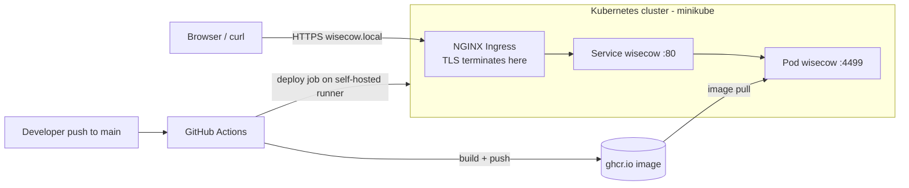

# Wisecow: Containerisation and Kubernetes Deployment with TLS and CI/CD

Containerised deployment of the [Wisecow](https://github.com/nyrahul/wisecow) application on Kubernetes, with an automated GitHub Actions pipeline and TLS (HTTPS) at the Ingress. The repository also contains two automation scripts (Problem Statement 2).

**Repository:** https://github.com/Rajeshkumar8967/Devops-Task

---

## Table of contents
1. [What this project does](#1-what-this-project-does)
2. [Architecture](#2-architecture)
3. [Repository layout](#3-repository-layout)
4. [Prerequisites](#4-prerequisites)
5. [Step 1: Run the container locally](#5-step-1-run-the-container-locally)
6. [Step 2: Start Kubernetes (minikube)](#6-step-2-start-kubernetes-minikube)
7. [Step 3: Create the TLS secret](#7-step-3-create-the-tls-secret)
8. [Step 4: Deploy to Kubernetes](#8-step-4-deploy-to-kubernetes)
9. [Step 5: Test over HTTP and HTTPS](#9-step-5-test-over-http-and-https)
10. [Step 6: CI/CD with GitHub Actions](#10-step-6-cicd-with-github-actions)
11. [Problem Statement 2: Scripts](#11-problem-statement-2-scripts)
12. [Troubleshooting and lessons learned](#12-troubleshooting-and-lessons-learned)
13. [Production improvements](#13-production-improvements)
14. [Screenshots](#14-screenshots)

---

## 1. What this project does

| Requirement | Implementation |
|---|---|
| Dockerize the app | `Dockerfile` (Ubuntu 22.04, non-root user) |
| Kubernetes manifests | `k8s/deployment.yaml`, `k8s/service.yaml`, `k8s/ingress.yaml` |
| Expose as a Service | `ClusterIP` Service on port 80, forwarding to container port 4499 |
| CI: build and push image | GitHub Actions job builds the image and pushes it to GitHub Container Registry (GHCR) |
| CD: auto deploy (challenge goal) | A second job on a self-hosted runner applies the manifests and rolls out the new image |
| TLS (challenge goal) | NGINX Ingress terminates TLS using a Kubernetes TLS secret |

## 2. Architecture



Traffic path: `HTTPS :443` to Ingress (TLS terminated, secret `wisecow-tls`) to Service `wisecow:80` to Pod `:4499`.

## 3. Repository layout

```
.
├── wisecow.sh                      # Application source (from nyrahul/wisecow)
├── Dockerfile                      # Container image definition
├── .gitattributes                  # Forces LF line endings for scripts
├── .gitignore                      # Keeps TLS key and cert out of Git
├── k8s/
│   ├── deployment.yaml             # Deployment (1 replica)
│   ├── service.yaml                # ClusterIP Service
│   ├── ingress.yaml                # Ingress with TLS
│   └── create-tls-secret.sh        # Linux helper to create the TLS secret
├── .github/workflows/ci-cd.yaml    # Build, push and deploy pipeline
├── scripts/
│   ├── system_health.sh            # Problem 2, objective 1
│   └── app_health_check.py         # Problem 2, objective 4
└── screenshots/                    # Proof of working deployment
```

## 4. Prerequisites

| Tool | Check command |
|---|---|
| Docker Desktop | `docker --version` |
| minikube | `minikube version` |
| kubectl | `kubectl version --client` |
| Git | `git --version` |
| Python 3.9+ (for the health checker) | `python --version` |

Commands below are PowerShell (Windows). Run them from the repository root.

## 5. Step 1: Run the container locally

```powershell
docker build -t wisecow .
docker run --rm -p 4499:4499 wisecow
```

In a second terminal:

```powershell
curl.exe http://localhost:4499
```

You should see a cow with a fortune. Wisecow serves **one request at a time**, so wait a second between requests. Stop the container with `Ctrl+C`.

**Dockerfile highlights**
- `fortune-mod`, `fortunes-min`, `cowsay` and `netcat-openbsd` are installed. `fortunes-min` provides the fortune data, which `--no-install-recommends` would otherwise skip.
- `/usr/games` is added to `PATH`, because `fortune` and `cowsay` install there.
- The app runs as a **non-root user** (UID 1001) from its own home directory, so it can create the `response` pipe the script needs.
- `sed -i 's/\r$//'` strips Windows line endings so the script runs on Linux.

## 6. Step 2: Start Kubernetes (minikube)

```powershell
minikube start --driver=docker --cpus=2 --memory=2200
minikube addons enable ingress
kubectl get nodes
kubectl get pods -n ingress-nginx
```

Expected: node `Ready`, and the `ingress-nginx-controller` pod `Running`.

## 7. Step 3: Create the TLS secret

Generate a self-signed certificate and store it as a Kubernetes TLS secret:

```powershell
& "C:\Program Files\Git\usr\bin\openssl.exe" req -x509 -nodes -newkey rsa:2048 -days 365 `
  -keyout tls.key -out tls.crt `
  -subj "/CN=wisecow.local/O=wisecow" `
  -addext "subjectAltName=DNS:wisecow.local"

kubectl create secret tls wisecow-tls --cert=tls.crt --key=tls.key
kubectl get secret wisecow-tls
```

On Linux or macOS you can run `./k8s/create-tls-secret.sh wisecow.local` instead.

`tls.key` and `tls.crt` are listed in `.gitignore`. **Never commit a private key.**

## 8. Step 4: Deploy to Kubernetes

The Deployment uses the image `ghcr.io/rajeshkumar8967/wisecow:latest`. Make the GHCR package **public** (GitHub profile, Packages, `wisecow`, Package settings, Change visibility) so the cluster can pull it without credentials.

```powershell
kubectl apply -f k8s/deployment.yaml -f k8s/service.yaml -f k8s/ingress.yaml
kubectl get pods
kubectl get svc
kubectl get ingress
```

Expected: one `wisecow` pod at `1/1 Running`.

## 9. Step 5: Test over HTTP and HTTPS

**Quick HTTP test with port-forward** (bypasses the Ingress):

```powershell
kubectl port-forward deployment/wisecow 7070:4499
```

In a second terminal: `curl.exe http://localhost:7070`

If your port is blocked by Windows, pick another. List reserved ranges with `netsh interface ipv4 show excludedportrange protocol=tcp`.

**HTTPS test through the Ingress**

1. In an **Administrator** PowerShell, start the tunnel and leave it open:
   ```powershell
   minikube tunnel
   ```
2. In a second **Administrator** PowerShell, map the host name:
   ```powershell
   Add-Content C:\Windows\System32\drivers\etc\hosts "127.0.0.1 wisecow.local"
   ```
3. In a normal terminal:
   ```powershell
   curl.exe -k -v https://wisecow.local
   ```

The output shows the TLS handshake (`TLSv1.3`, `subject: CN=wisecow.local`) followed by the cow. `-k` is needed only because the certificate is self-signed. In a browser, open https://wisecow.local, click **Advanced**, then **Proceed to wisecow.local (unsafe)**. The warning `NET::ERR_CERT_AUTHORITY_INVALID` is expected for a self-signed certificate.

## 10. Step 6: CI/CD with GitHub Actions

Workflow file: [`.github/workflows/ci-cd.yaml`](.github/workflows/ci-cd.yaml). It runs on every push to `main` (and manually via `workflow_dispatch`).

| Job | Runner | What it does |
|---|---|---|
| `build-and-push` | `ubuntu-latest` | Logs in to GHCR, builds the image, pushes it tagged with the commit SHA and `latest` |
| `deploy` | `self-hosted` (local PC) | Applies the manifests, sets the new image tag, waits for the rollout |

**Why a self-hosted runner?** The cluster runs on a local machine (minikube), which GitHub-hosted runners cannot reach. The self-hosted runner runs on the same machine as `kubectl`. With a cloud cluster (EKS/GKE/AKS), a hosted runner plus a kubeconfig secret would work instead.

**Setting up the runner**

1. Repo, **Settings, Actions, Runners, New self-hosted runner**, choose Windows.
2. Run the download and extract commands shown, then `./config.cmd --url ... --token ...` (press Enter for the defaults, answer `N` for "run as service").
3. Start it and leave it open:
   ```powershell
   ./run.cmd
   ```
4. The runner shows **Idle** on the Runners page.

**Other required settings**
- **Settings, Actions, General, Workflow permissions**: Read and write (so the pipeline can push packages).
- The deploy job uses `shell: powershell`. Using `shell: bash` on a Windows runner can pick up the WSL launcher and fail.

**Verify a deployment**

```powershell
kubectl get pods
kubectl describe deployment wisecow | findstr Image
```

The image tag should match the latest commit SHA.

**Security note:** a self-hosted runner executes code on your computer. The workflow only triggers on pushes to `main`. Keep **Require approval for all outside collaborators** enabled for fork pull requests, and stop the runner when you are not testing.

## 11. Problem Statement 2: Scripts

I chose two objectives:
1. **System Health Monitoring Script** (`scripts/system_health.sh`, Bash)
4. **Application Health Checker** (`scripts/app_health_check.py`, Python)

### 11.1 Application Health Checker (Python)

Checks one or more URLs and reports `UP` or `DOWN` from the HTTP status code.
- **UP**: HTTP 200 to 399
- **DOWN**: HTTP 400 and above, timeout, connection refused, DNS failure, or TLS error
- Exit code `0` if all apps are UP, `1` if any is DOWN, `2` if no URL was given

**Run it** (works on Windows, Linux and macOS):

```powershell
python scripts/app_health_check.py http://localhost:4499
python scripts/app_health_check.py http://localhost:7070 https://example.com
```

**Try it on Wisecow**

1. Start the app: `docker run -d --rm --name wisecow-test -p 4499:4499 wisecow`
2. Check it: `python scripts/app_health_check.py http://localhost:4499` shows `[UP]`
3. Stop it: `docker stop wisecow-test`
4. Check again: it shows `[DOWN]`, with the reason "no response (Connection refused)"
5. Check the exit code: `echo $LASTEXITCODE` (PowerShell)

Example output:

```
[UP  ] http://localhost:4499 - HTTP 200 in 12ms
[DOWN] http://localhost:1 - no response (<urlopen error [Errno 111] Connection refused>)
```

Because Wisecow serves one request at a time, do not run the checker in a tight loop against it.

Note: the checker verifies TLS certificates. Against the self-signed `https://wisecow.local` it will report DOWN with a certificate error. Use the HTTP port-forward address, or a publicly trusted certificate, for checks.

### 11.2 System Health Monitor (Bash)

Checks CPU usage, memory usage, disk usage and the number of running processes. If a metric exceeds its threshold, it prints an `ALERT` to the console and appends it to a log file. Every run also logs a one-line snapshot.

| Variable | Default | Meaning |
|---|---|---|
| `CPU_THRESHOLD` | 80 | CPU percent |
| `MEM_THRESHOLD` | 80 | Memory percent |
| `DISK_THRESHOLD` | 80 | Disk percent for `/` |
| `PROC_THRESHOLD` | 300 | Number of processes |
| `LOG_FILE` | `./system_health.log` | Log location |
| `INTERVAL` | 0 | Seconds between checks (0 = run once) |

This script reads `/proc` and uses `free`, so it needs **Linux**. Windows PowerShell and Git Bash do not provide these. Use one of the options below.

**Option A: WSL (Ubuntu)**

```bash
chmod +x scripts/system_health.sh
./scripts/system_health.sh                          # run once
CPU_THRESHOLD=5 ./scripts/system_health.sh          # low threshold to trigger an alert
INTERVAL=30 ./scripts/system_health.sh              # check every 30 seconds
```

**Option B: Docker (no WSL needed)**, run from the repository root:

```powershell
docker run --rm -v "${PWD}/scripts:/s" ubuntu:22.04 bash -c "apt-get update -qq && apt-get install -y -qq procps > /dev/null && sed 's/\r$//' /s/system_health.sh | CPU_THRESHOLD=5 bash"
```

This measures the Docker VM, not Windows itself, which is fine for demonstrating the script.

Example output:

```
2026-11-25 12:40:01 ALERT: CPU usage 12% exceeds 5%
cpu=12% mem=34% disk=29% procs=67
```

**Line endings:** if you see `bad interpreter` or `\r` errors, the file has Windows line endings. In VS Code, click `CRLF` in the status bar, choose `LF`, and save. The `.gitattributes` file prevents this in future.

## 12. Troubleshooting and lessons learned

| Problem | Cause | Fix |
|---|---|---|
| `/usr/bin/env: 'bash\r': No such file` | Windows CRLF line endings in `wisecow.sh` | Convert to LF, add `.gitattributes`, strip `\r` in the Dockerfile |
| `mkfifo: Permission denied` | Non-root user cannot write to a root-owned directory | Run from the user's home directory, owned by that user |
| `No fortunes found` | `--no-install-recommends` skipped the fortune data | Install `fortunes-min` |
| `port is already allocated` | An older container still holds port 4499 | `docker ps`, then `docker stop <id>` |
| `InvalidImageName` | Placeholder or uppercase letters in the image name | Use the lowercase `ghcr.io/<username>/wisecow` |
| `ImagePullBackOff` | Image not pushed, or GHCR package private | Check the Actions run, set the package to Public |
| `apiserver: Stopped`, TLS handshake timeout | Docker Desktop short on memory | Raise memory in Docker or `.wslconfig`, or recreate minikube |
| Port-forward: `connection refused` | TCP health probes consumed Wisecow's single netcat listener | Removed readiness and liveness probes for this app |
| Port-forward: bind not permitted | Windows reserved the local port | Use another local port |
| Workflow: `Unexpected value 'deploy'` | `deploy:` was indented under the previous job | Align it with `build-and-push:` |
| Deploy job queued forever | No self-hosted runner registered or running | Run `config.cmd`, then `run.cmd` |
| `Bash/Service/0x8007274c` | `shell: bash` resolved to the WSL launcher | Use `shell: powershell` |
| Browser: `ERR_CERT_AUTHORITY_INVALID` | Self-signed certificate | Expected; proceed manually, or trust the cert locally |

**Key lessons:** non-root containers need writable paths; Windows line endings break Linux scripts; health probes must suit how the app serves connections; and pinning deployments to a commit SHA makes every rollout traceable.

## 13. Production improvements

- Use a managed cluster (EKS, GKE or AKS) and a GitHub-hosted runner with the kubeconfig as an encrypted secret.
- Use **cert-manager** with Let's Encrypt for publicly trusted, auto-renewing certificates, with a real domain name.
- Rewrite the app server to handle concurrent connections, then add proper readiness and liveness probes.
- Add image vulnerability scanning (for example Trivy) to the CI pipeline.
- Store manifests in Helm or Kustomize for environment-specific values.
- Add resource autoscaling (HPA) and a `PodDisruptionBudget`.

## 14. Screenshots

Place images in the `screenshots/` folder and adjust the file names to match.

| Step | Screenshot |
|---|---|
| Container running locally |  |
| Pods, Service and Ingress |  |
| HTTPS test with TLS handshake |  |
| Browser at `https://wisecow.local` |  |
| Green GitHub Actions run (build and deploy) |  |
| Image in GHCR |  |
| Health checker output |  |
| System health output |  |

---

*Source application: [nyrahul/wisecow](https://github.com/nyrahul/wisecow).*
